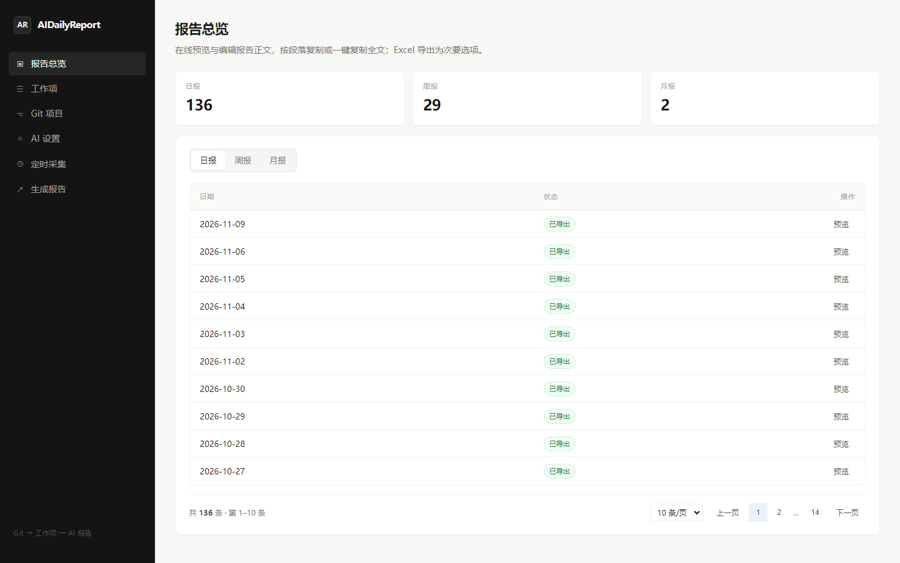
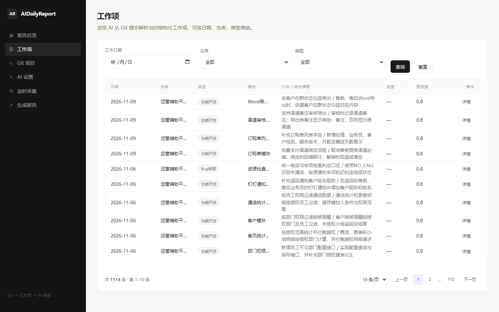
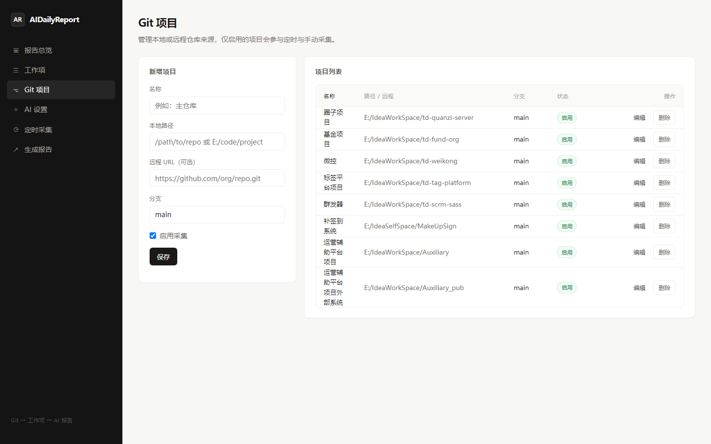
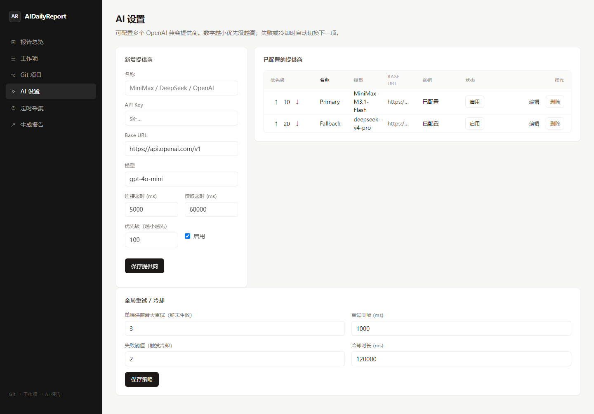
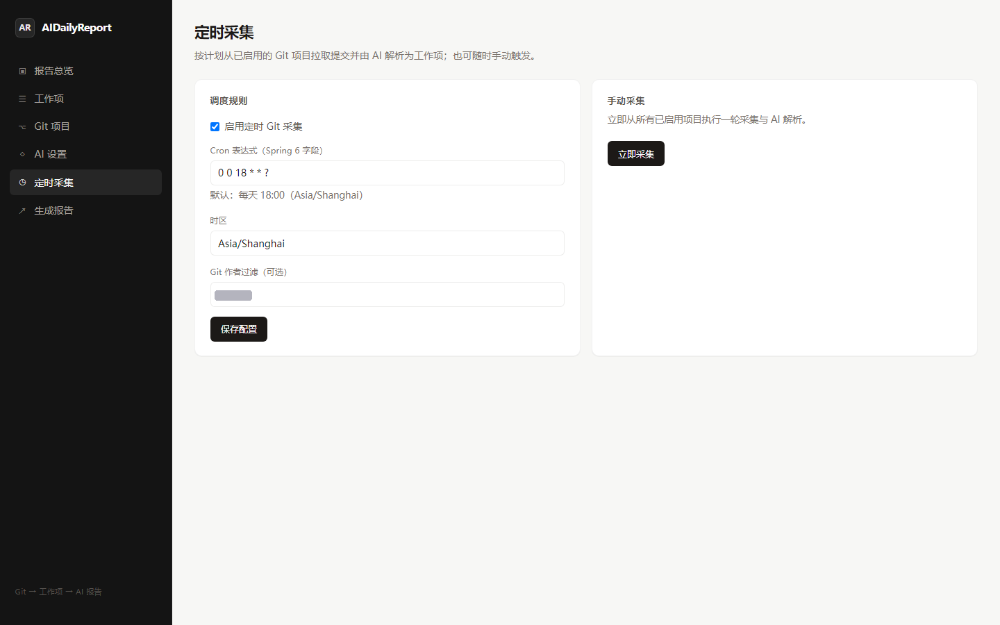
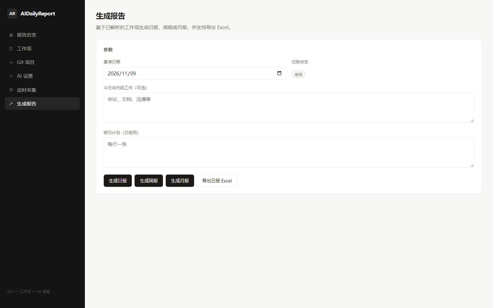

# AIDailyReport

**English:** Turn Git commits into structured work items and AI-enhanced daily / weekly / monthly reports, with a built-in Vue 3 Web UI and optional Windows packaging.

**中文：** 从 Git 提交自动解析工作项，经多 AI 提供商生成日报 / 周报 / 月报；提供现代化 Web 管理界面，可打包为 Windows 便携应用。

> 开发分支：`feature/ai-dailyreport` · [Pull Request #1](https://github.com/w735937076/AIDailyReport/pull/1)

## 界面预览 / Screenshots

| | |
|---|---|
|  | **报告总览** — 分页浏览日报 / 周报 / 月报，在线预览、按段落复制、编辑正文 |
|  | **工作项** — 查看 AI 从 commit 解析出的结构化任务，支持筛选与详情 |
|  | **Git 项目** — 配置多仓库本地路径或远程 URL，启用后加入采集 |
|  | **AI 配置** — 多 OpenAI 兼容提供商、优先级与全局重试 / 冷却策略 |
|  | **定时任务** — Cron 定时采集 + 手动「立即采集」，支持作者过滤 |
|  | **生成报告** — 一键生成日 / 周 / 月报并导出 Excel，异步进度展示 |

## 项目是做什么的

```
Git 提交 → 解析 diff / message → work_item（计划 / 做法 / 进度…）
                                    ↓
                         聚合 + AI 增强 → daily_report / period_report
                                    ↓
                         Web 预览 · 编辑 · 复制 · Excel 导出
```

典型场景：个人或小团队管理多个本地 Git 仓库，按**上海时区「今天」**在**有提交的所有本地分支**上采集，只保留配置作者的 commit；AI 将每条 commit 结构化为工作项，再汇总成符合模板的 TXT / Excel 报告。

### 主要特性

- **多仓库**：Web 配置多个 `path` 或 `remote` 项目，启用的仓库参与定时与手动采集
- **本地分支智能采集**：仅扫描 `refs/heads/*`；仅对「今日有匹配作者提交」的分支做 `--since` 采集；`(repo_name, commit_id)` 去重
- **多 AI 提供商**：`app_ai_provider` 按 priority  failover，冷却与重试可配
- **Web UI**：Vue 3 + Vite 嵌入 Spring Boot `static/`，报告抽屉支持分段复制、双击编辑、失焦后点击自动保存
- **异步任务**：采集 / 生成报告返回 `jobId`，前端轮询进度
- **绩效评估（独立模块）**：按月汇总 Git / `work_item`，AI 长文 + 官方 Excel 模板填充；与「生成月报」/`period_report` 分离
- **Windows**：`scripts/package-windows.ps1` / `jpackage` 生成便携目录或 `.exe`（需在 Windows 上完成 exe 步骤）

## 技术栈

| 层级 | 技术 |
|------|------|
| 后端 | Java 17 · Spring Boot 3 · MyBatis · JGit |
| 前端 | Vue 3 · Vite（构建产物在 `src/main/resources/static`） |
| 数据库 | MySQL 5.7+ / 8.x |
| AI | OpenAI 兼容 HTTP API（Minimax / DeepSeek / 自建等） |

## 环境要求

| 组件 | 版本 |
|------|------|
| JDK | 17+ |
| Maven | 3.8+ |
| MySQL | 5.7+ / 8.x |
| Node.js | 18+（仅前端开发或重构建 UI 时需要） |

## 快速开始

### 1. 数据库

创建库 `dailyreport`（或在 JDBC URL 中启用自动创建）。执行 `src/main/resources/schema.sql`（核心表）及 `schema_web.sql`（Web 配置表）。

**核心四表结构请勿随意变更：** `git_commit_log`、`work_item`、`daily_report`、`period_report`。

### 2. 连接与密钥

- 在 `src/main/resources/application.yml` 中配置 `spring.datasource.*`，或用环境变量覆盖密码。
- **勿将真实密码或 API Key 提交 Git。**
- 复制 **[`config.example.yaml`](config.example.yaml)** 为项目根目录的 `config.yaml`（已在 `.gitignore`）。首次启动且项目表为空时，可从 YAML **一次性导入** 示例仓库与 AI 占位配置。

### 3. 构建与运行

```bash
mvn -q -DskipTests package
java -jar target/dailyreport-1.0.0.jar
```

浏览器打开 [http://localhost:18080](http://localhost:18080)（默认 `app.open-browser=true` 会尝试自动打开）。

### 4. 前端单独开发（可选）

```bash
# 终端 1
mvn spring-boot:run

# 终端 2：Vite 代理 /api → 18080
cd frontend && npm install && npm run dev
```

生产构建（写入 `src/main/resources/static`）：

```bash
cd frontend && npm run build
```

## Web 页面与 API 速览

| 页面 | 主要 API |
|------|-----------|
| 报告总览 | `GET /api/reports/daily`、`GET /api/reports/period/{type}`、`GET/PUT /api/reports/daily/id/{id}` |
| 工作项 | `GET /api/work-items?workDate&repoName&type&page&size`、`GET /api/work-items/{id}` |
| Git 项目 | `GET /api/projects`、`POST/PUT/DELETE /api/projects/{id}` |
| AI 设置 | `GET /api/ai/providers`、`GET/PUT /api/ai/policy` |
| 定时采集 | `GET/PUT /api/scheduler`、`POST /api/collect/now` → `jobId`，`GET /api/jobs/{id}` |
| 生成报告 | `POST /api/reports/{daily,weekly,monthly}/generate` → `jobId` |

列表接口统一分页：`page`（从 1）、`size`（≤100），响应 `{ items, total, page, size }`。

## 数据采集说明（本地仓库）

1. 列出所有**本地分支** `refs/heads/*`（不含 remote-tracking）。
2. 用 **Asia/Shanghai** 当日 0 点起的时间窗 + **作者过滤**（调度页 / `config` 中的 Git 用户名）判断分支是否「今日活跃」。
3. 仅对活跃分支执行 JGit log（时间过滤，非盲目 `maxCount(100)`）。
4. 日志会输出活跃分支列表及各分支新增条数。

远程仓库仍按配置的**单一 branch** 克隆后走同一套本地采集逻辑。

## Windows 打包

在 **Windows**（JDK 17+、Maven）上：

```powershell
.\scripts\package-windows.ps1
```

或在 Git Bash / Linux 生成 app-image 骨架（完整 `.exe` 需在 Windows 执行 `jpackage --type exe`）：

```bash
bash scripts/package-windows.sh
```

产物：`dist/win/`。亦可直接分发 fat jar：`java -jar target/dailyreport-1.0.0.jar`。

## 配置项摘要

| 键 | 默认 | 说明 |
|----|------|------|
| `server.port` | `18080` | HTTP 端口 |
| `app.cli.enabled` | `false` | 旧版交互 CLI |
| `app.open-browser` | `true` | 启动打开浏览器 |
| `config.yaml` | 可选 | 见 `config.example.yaml` |

## 安全与仓库规范

- 仅提交 **`config.example.yaml`**，不要提交 `config.yaml`、真实数据库密码或 API Key。
- 响应中的 API Key 字段脱敏；更新时 Web 端传 `__UNCHANGED__` 表示不修改密钥。

## 架构示意

```
Git 项目（DB） → GitCollectService → AiParseService → work_item
                              ↓
                    ReportGenerateService → daily_report / period_report
                              ↓
Vue SPA  ←REST /api/*→  Spring Boot  ←MyBatis→  MySQL
```

- **Web 配置表**（见 `schema_web.sql`）：`app_git_project`、`app_ai_provider`、`app_scheduler_config`、`app_setting`、`performance_review`

### 绩效评估与 MonthPerformance 迁移

1. 在侧栏打开 **绩效评估**，配置部门 / 岗位 / 被评估人 / 分数与模板路径。
2. `config.yaml` 的 `performance.templateSearchDir` 可指向本机历史目录（例如 `E:/IdeaSelfSpace/MonthPerformance`），系统会选用该目录下最新的 `.xlsx` 作为 **样式模板**（不复制含真实姓名的文件到 git）。
3. 将公司空白表放到 `./templates/performance/performance_template.xlsx`（该路径下的 xlsx 已在 `.gitignore`）；若缺失，首次导出会生成最小占位模板。
4. 生成结果写入 `./output/performance/`，可通过 Web 预览编辑 D5 / D12 / D15 / B38 后重新导出；默认分数 55 + 18 + 20 + 0 = 93，可在配置中修改。
- **CLI**：设置 `app.cli.enabled=true` 可启用遗留菜单

## 许可证

见 [LICENSE](LICENSE)。
